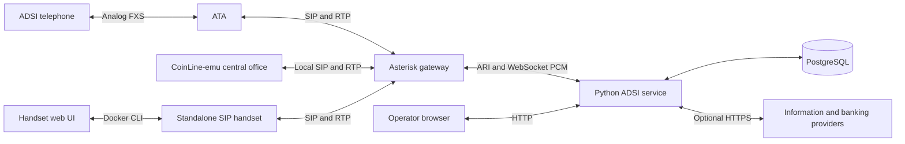

# CoinLine ADSI

CoinLine ADSI is a lab server that paints menus on Analog Display Services Interface (ADSI) telephones during a call. It is for telephone collectors, telephony hobbyists and anyone interested in making 1990s screenphones useful again. The server sends display text and softkey assignments as audio, and listens for the phone's keypad and softkey tones.

It is a companion to CoinLine, the payphone management and calling system, and CoinLine-emu, the payphone and central office simulator. It runs independently of both. Try it without a vintage telephone using the included software SIP handset.

[](https://github.com/andrew867/CoinLine-ADSI/actions/workflows/ci.yml) [MIT License](LICENSE)

The bundled **InfoLine** application provides Canadian news, weather, stock quotes, lottery results, flight information, local directory search, road and ferry reports, transit schedules, cinema showtimes and parcel tracking. The default uses synthetic data. Private banking and the separate ShadyBank virtual-credit service are optional.

## Quick start

Install Docker with Compose and Python 3.11 or later. On Windows use an MSYS2 MINGW64 shell with Docker and Python on its path. Start Docker before running these commands.

**The first build takes a long time.** It compiles Asterisk 22.12.0 from source with a small set of modules, as well as the software handset. Subsequent builds can reuse Docker's build cache.

```sh
git clone https://github.com/andrew867/CoinLine-ADSI.git
cd CoinLine-ADSI
python deploy/init_lab.py
docker compose --profile verify build gateway app terminal-emu
docker compose --profile verify up -d --no-build --wait gateway app
```

The initializer creates an ignored `.env` file with local credentials. Print just the console access code, not the entire file:

```sh
sed -n 's/^ADSI_ADMIN_PASSWORD=//p' .env
```

1. Open the [operator console](http://127.0.0.1:8080) and sign in with that code. **Applications** is the graph editor, revision history and fixture simulator. **Setup** shows incoming routes and lets you validate and save provider settings and configure the resident feature.
2. From the checkout, run `python terminal-emu/view.py` in a separate shell and open the [SIP handset](http://127.0.0.1:8091). This local web UI starts the `terminal-emu` container when you dial; it makes an actual SIP call over the Docker network rather than just previewing a graph.
3. Dial **6501** for InfoLine. Use the onscreen softkeys or the numeric keypad to navigate. No live provider keys or real accounts are required.

The welcome screen reads `COINLINE INFOLINE`. Its keys are 1 News, 2 Weather, 3 Finance, 4 Lotto, 5 More and 0 Exit. More opens Flights, Directory (Dir), Travel, Movies and Parcels. Travel contains road conditions, ferry status and transit; weather alerts are under Weather. The optional information assistant is under Travel. User-published application revisions can change the menus.

The handset UI accepts an optional synthetic caller ID. A configured NPA-NXX assignment can suggest a city, which the caller can confirm or change. An area code and exchange are not a physical location.

## Extensions

| Dial | Service | Availability |
| --- | --- | --- |
| 6500 | ADSI `LAB` exchange and voice fallback | Default |
| 6501 | Published InfoLine application | Default |
| 6502 | Synthetic balance and activity | Generated `ADSI_DEMO_PIN` |
| 6503 | Resident feature / InfoLine launcher | `ADSI_FDM_ENABLE=1` and one-use approval |
| 6504 | Private local InfoLine and read-only SimpleFIN | Local enrollment and private calls enabled |
| 6505 | Native Asterisk voicemail access | Optional `compose.native.yaml` |
| 6506 | Native Asterisk visual directory | Optional `compose.native.yaml` |
| 6507 | Leave a voicemail in the lab mailbox | Optional `compose.native.yaml` |
| 6508 | ShadyBank card/PIN, balance, history, holds and transfers | `ADSI_SHADYBANK_MODE=demo` or `live` |
| 2374 | InfoLine from CoinLine-emu | Separate `compose.emu.yaml` instance only |

The standard extensions require the authenticated `lab` SIP endpoint. The emulator-only 2374 route cannot reach the private, download or native mail extensions. See [running the lab](docs/plan/running.md), [native mail and resident features](docs/plan/extra-services.md) and [ShadyBank](docs/plan/shadybank.md) for setup instructions.

## Connecting a telephone

### CoinLine-emu

The central office simulator can place a regular local SIP call to a separate InfoLine instance. It carries the ADSI tones in the audio, without a special application interface. Use Docker Compose 2.24.4 or later for the overlay:

```sh
python deploy/init_lab.py
docker compose -p coinline-adsi-emu -f compose.yaml -f compose.emu.yaml --profile verify build gateway app terminal-emu
docker compose -p coinline-adsi-emu -f compose.yaml -f compose.emu.yaml --profile verify up -d --no-build --wait gateway app
```

Map the desired dialled number in the central office simulator to `sip:2374@127.0.0.1:5069`, with SIP From user `co`, UDP, PCMU and in-band DTMF. There is no SIP registration or Digest authentication on this named local endpoint. Keep it on host loopback. The separate console is at [127.0.0.1:8089](http://127.0.0.1:8089), with negotiated RTP ports in 18100-18139. For an emulated terminal that requires voice between screens, set `ADSI_EMU_INTERACTION_PROFILE=voice-between-screens` when starting that overlay. See the [emulator connection contract](docs/plan/millennium-interop.md).

### A real ADSI phone

Connect the phone to the FXS port of an analog telephone adapter (ATA). Use an authenticated SIP peer with username `lab` and the generated `ADSI_SIP_PASSWORD` to call 6501 on port 5060. SIP and RTP bind to loopback by default; for a physical ATA, configure a reachable local bind address (`ADSI_BIND`) and verify the advertised media address and two-way RTP. Do not expose this lab to the public internet.

- Select G.711 PCMU (also called mu-law or `ulaw`) and in-band DTMF. Disable echo cancellation and, where available, silence suppression for the test.
- ADSI data travels in the voice channel: CAS, Bell 202 FSK and the phone's DTMF acknowledgments must survive the ATA and SIP media path intact.
- Vista 350 and ADSI-capable Millennium are target devices, but neither is physically qualified yet. The standalone SIP handset, native Asterisk reference and one terminal-in-emulator interactive profile have separate verified results. See [protocol and qualification](docs/spec/adsi-protocol.md) and [emulator results](docs/status/voice-profile-lab.md).

## Architecture



The standard and CoinLine-emu gateways are separate instances when both configurations are running. Asterisk handles calls and audio transport. The Python service creates ADSI messages, runs applications and retrieves data. PostgreSQL stores application revisions and settings. Synthetic provider and wire fixtures are JSON files under [`fixtures/`](fixtures/README.md), not a separate Compose service.

## App environment

The following variables are passed to the `app` container by `compose.yaml`. Values marked generated come from `deploy/init_lab.py`; blank means an optional setting is unset. Put local settings in `.env`, never commit credentials, and recreate the app after changing its environment (`docker compose up -d --wait app`). For provider-specific activation, use the corresponding Setup configuration as described in [the run guide](docs/plan/running.md).

| Variable | Default | Purpose |
| --- | --- | --- |
| `ADSI_ARI_URL` | `http://gateway:8088` | Internal Asterisk API |
| `ADSI_ARI_PASSWORD`, `ADSI_ADMIN_PASSWORD`, `ADSI_DATABASE_PASSWORD` | Generated, required | Gateway, console and database access |
| `ADSI_DB_HOST` | `db` | Internal PostgreSQL host |
| `ADSI_SIP_BIND` | `127.0.0.1` | Mirrors the Compose host `ADSI_BIND` setting |
| `ADSI_DEMO_PIN`, `ADSI_DATA_KEY` | Generated by initializer; otherwise blank | Synthetic balance PIN and private encryption key |
| `ADSI_LOCAL_BANK_ENROLLMENT`, `ADSI_LOCAL_PRIVATE_CALLS`, `ADSI_PRIVATE_BALANCES` | `0` | Opt-in private balance modes |
| `ADSI_WEB_ORIGIN` | Blank (request origin) | Explicit web origin, HTTPS for shared private service |
| `ADSI_OIDC_DISCOVERY`, `ADSI_OIDC_CLIENT`, `ADSI_OIDC_SECRET` | Blank | Optional identity provider configuration |
| `ADSI_OIDC_OPERATOR_SUBJECTS` | Blank (no operator roles) | JSON identity-to-console-role map |
| `ADSI_FDM_ENABLE` | `0` | Resident feature download |
| `ADSI_REGIONAL_ENABLE` | `0` | Canadian regional live providers |
| `ADSI_FEED_NEWS_URL`, `ADSI_FEED_MARKET_URL`, `ADSI_FEED_LOTTERY_URL` | Blank | Optional approved HTTPS feeds |
| `ADSI_FEED_NEWS_KEY`, `ADSI_FEED_MARKET_KEY`, `ADSI_FEED_LOTTERY_KEY` | Blank | Optional bearer credentials for their feeds |
| `ADSI_MODEL_URL`, `ADSI_MODEL_NAME`, `ADSI_MODEL_KEY` | Blank | Optional model endpoint, name and credential |
| `ADSI_HEADLINEFEED_KEY`, `ADSI_ALPHA_VANTAGE_KEY`, `ADSI_TWELVE_DATA_KEY` | Blank | Financial news and market data credentials |
| `ADSI_AVIATIONSTACK_KEY`, `ADSI_CINEPLEX_API_KEY`, `ADSI_NL511_KEY` | Blank | Flight, cinema and road/ferry data credentials |
| `ADSI_METROBUS_ENABLE`, `ADSI_METROBUS_GTFS_ACCEPTED` | `0` | Metrobus data and accepted GTFS download terms |
| `ADSI_METROBUS_GTFS_PATH` | Blank | Optional schedule file path inside the container |
| `ADSI_FEDEX_CLIENT_ID`, `ADSI_FEDEX_CLIENT_SECRET` | Blank | Parcel tracking credentials |
| `ADSI_FEDEX_SANDBOX` | `0` | Use the FedEx sandbox when tracking is enabled |
| `ADSI_SHADYBANK_MODE` | `disabled` | `demo` or `live` enables ShadyBank |
| `ADSI_SHADYBANK_URL`, `ADSI_SHADYBANK_SERVICE_KEY` | Blank | Live member-service HTTPS endpoint and key |
| `ADSI_SHADYBANK_INTERACTION_PROFILE` | `voice-between-screens` | ShadyBank media interaction profile |
| `ADSI_PROVIDER_CACHE_DIR` | `/var/lib/coinline/providers` | Persistent public-provider cache |

## Troubleshooting

- **Build still running:** the first Asterisk and handset builds compile native software. Allow them to finish. Check `docker compose ps -a` if startup fails and `docker compose logs --tail=100 app gateway` for the cause.
- **Cannot sign in:** make sure you are using `ADSI_ADMIN_PASSWORD`, not the SIP password or demo PIN. The initializer preserves existing values.
- **Handset will not dial:** start `terminal-emu/view.py` from the checkout and confirm Docker is running. The verification profile must have built `terminal-emu`. Dial 6500 to check the basic exchange.
- **Voice but no display:** verify PCMU, in-band DTMF, two-way audio and the absence of echo cancellation. Check the CAS/A, FSK and D1 exchange on a synthetic lab call. If the phone does not acknowledge, the public application can fall back to voice.
- **Live result unavailable:** check the provider's Setup settings, key, quota and network connection. Enabled provider failures are not silently replaced with demo records.

## Documentation and tests

- [Running the lab](docs/plan/running.md), [operations and delivery](docs/plan/operations.md)
- [Protocol](docs/spec/adsi-protocol.md), [application platform](docs/spec/application-platform.md), [requirements](docs/spec/requirements.md), [verification plan](docs/test/verification.md), [development and qualification gates](docs/plan/development.md)
- [Data and access](docs/spec/data-and-access.md), [regional providers](docs/spec/regional-providers.md), [screenphone services](docs/plan/screenphone-experience.md), [NL travel](docs/plan/nl-travel.md), [ShadyBank](docs/plan/shadybank.md)
- [Local lab results](docs/status/local-lab.md), [Canadian provider tests](docs/status/regional-lab.md), [sources](docs/sources.md)

To run the 79 Python unit tests and design checks without a SIP server:

```sh
python -m pip install -r service/requirements.txt
PYTHONPATH=service python -m unittest discover -s tests -v
python tests/check_design.py
```

GitHub Actions also builds the lab and tests real SIP calls, the browser console, the emulator ingress and the optional native Asterisk modules. The software test results are not evidence of physical handset compatibility.

## Glossary

| Term | Meaning |
| --- | --- |
| ADSI | Analog Display Services Interface, telephone screen and softkey control over audio |
| CAS / FSK | CPE Alerting Signal / Frequency-Shift Keying, the alert tone and Bell 202 data modulation |
| SDC / FDM | Server Display Control / Feature Download Management, live screens and resident feature downloads |
| CPE | Customer Premises Equipment, here the telephone or terminal |
| SIP / RTP / UDP | Session Initiation Protocol / Real-time Transport Protocol / User Datagram Protocol, call signaling and media transport |
| DTMF | Dual-Tone Multi-Frequency, keypad, softkey return and acknowledgment tones |
| PCM / PCMU | Pulse-Code Modulation / mu-law PCM (G.711), the digital audio format |
| ARI / API / REST | Asterisk REST Interface / Application Programming Interface / Representational State Transfer |
| FXS / ATA | Foreign Exchange Station / Analog Telephone Adapter, the analog subscriber port and SIP adapter |
| NPA-NXX | Numbering Plan Area (area code) and central office exchange code, the first six digits of a North American number |
| HTTP / HTTPS / TLS | Hypertext Transfer Protocol / HTTP Secure / Transport Layer Security |
| OIDC | OpenID Connect, optional web sign-in |
| JSON / RSS / GTFS | JavaScript Object Notation / Really Simple Syndication / General Transit Feed Specification |
| PIN / UI / CLI | Personal Identification Number / User Interface / Command-Line Interface |

## License

CoinLine ADSI is licensed under the [MIT License](LICENSE), copyright Andrew Green. Asterisk, PJPROJECT, SpanDSP and other third-party dependencies retain their own licenses.
